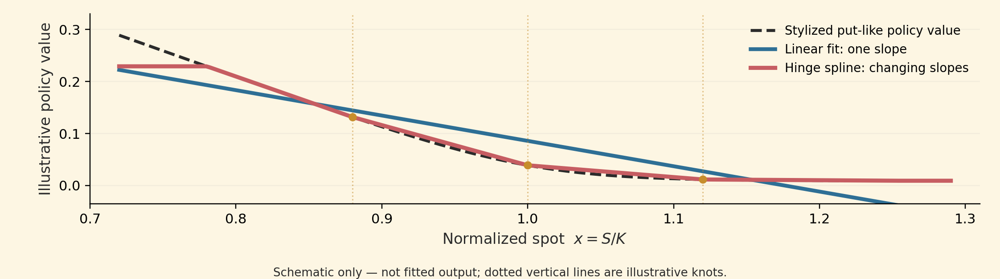

## Why early-exercise options are harder to price

::: {.columns}
::: {.column width="48%"}
**When can the holder exercise?**

- **European:** only at maturity, $T$.
- **American:** at any time up to $T$.
- **Bermudan:** at prescribed dates, $t_0,t_1,\ldots,T$.
:::
::: {.column width="48%"}
**The problem studied here**

- Approximate American-style puts using **monthly Bermudan exercise opportunities**.
- Vanilla put: 13 eligible dates, including $t_0$.
- Asian put: six eligible monthly dates, starting at month 1.
:::
:::

$$
\underbrace{P_{\rm Eur}=\mathbb E^{\mathbb Q}[e^{-rT}g_T]}_{\text{fixed exercise date}}
\qquad\text{vs.}\qquad
\underbrace{V_0=\sup_{\tau\in\mathcal T}\mathbb E^{\mathbb Q}[e^{-r\tau}g_{\tau}]}_{\text{choose when to exercise}}
$$

**Motivation:** European pricing fixes the exercise date; American pricing must also choose **when to stop**. Trees/PDEs suit simpler state spaces; Monte Carlo handles path dependence but adds **payoff noise**—the problem EH addresses.

::: {.notes}
0:30 — Emphasize that Black--Scholes PDE methods can still price American options numerically; only the European closed form does not directly solve optimal stopping.
:::

## Conventional pricing: continuation versus exercise

**At each permitted date, should the holder exercise now or wait?**
The immediate payoff is known; the value of waiting is a conditional expectation. Here $\Delta$ is one exercise interval and $V_{k+1}$ is the next-date option value.

$$
\underbrace{g_k(X_k)=(K-S_k)^+}_{\text{exercise now}}
\quad\text{vs.}\quad
\underbrace{C_k(X_k)=e^{-r\Delta}\,\mathbb E^{\mathbb Q}[V_{k+1}(X_{k+1})\mid X_k]}_{\text{continue}}
$$

**Exercise if** $g_k(X_k)\geq\widehat C_k(X_k)$, using a fitted continuation value.

- **Longstaff--Schwartz (LSM):** regress discounted *realized future exercise cashflows* onto state features, typically on in-the-money paths. For a vanilla put, $\widehat C_k(x)=\beta_{k,0}+\beta_{k,1}x+\beta_{k,2}x^2$, with $x=S_k/K$ and fitted weights $\beta_{k,j}$.
- **Tsitsiklis--Van Roy (TVR):** a related backward fitted-value approach, using *next-step estimated values* as regression targets.

**LSM fits the stopping rule; EH targets the remaining pricing noise.**

::: {.notes}
0:35 — $g_k$ is immediate exercise value; $C_k$ is true continuation; $\widehat C_k$ is its fitted approximation. TVR is contextual, not an experimental comparator.
:::

## Ehrlichman--Henderson (2007): paper overview

**Objective.** Make simulation-based valuation of American-style options more efficient, including path-dependent and multi-dimensional contracts.

**Approach.** Fit the option/policy value at successive dates using **multivariate adaptive regression splines (MARS)**. Choose hinge basis functions whose one-step conditional expectations can be computed without nested simulation.

**Estimator.** Combine fitted values and their conditional expectations into a **mean-zero martingale**. Subtract its value at the exercise time from the discounted payoff to reduce noise in a lower-bound estimate. A related martingale also yields a dual **upper bound**.

**Theory and experiments.** The exact policy-value function gives a *zero-variance* control; practical approximations can substantially reduce variance. The paper studies Asian, basket and barrier options under several dynamics.

*Our focus:* isolate this martingale-CV idea using frozen LSM exercise policies and **fixed-knot additive splines**, not the paper's full adaptive MARS, policy improvement, or dual upper-bound algorithm.

*Source: Ehrlichman & Henderson (2007), §§2–5.*

::: {.notes}
0:35 — Explain objective → approximation → correction → mathematical promise. Do not assume the audience knows paper-specific proposition numbering.
:::

## What exactly are we estimating?

Let $\pi$ be the **exercise/continue rule fitted by LSM** and $\tau^\pi$ its **first selected exercise date**, or maturity if the option is never exercised early.

Write $X_k$ for the **state observed at date $k$** (stock price for vanilla; stock price and running average for Asian) and $g_k(X_k)$ for the exercise payoff.

$$
Y=e^{-rt_{\tau^\pi}}g_{\tau^\pi}(X_{\tau^\pi}),
\qquad
L_0^\pi=\mathbb E^{\mathbb Q}[Y]\leq V_0.
$$

**Plain LSM Monte Carlo** prices this *fixed policy* by averaging independent discounted payoffs:

$$
\widehat L_{\rm plain}=\frac1N\sum_{i=1}^N Y_i,
\qquad
\operatorname{Var}(\widehat L_{\rm plain}\mid\pi)=\frac{\operatorname{Var}(Y\mid\pi)}{N}.
$$

LSM has already determined **when** to exercise. The remaining question is how to estimate $L_0^\pi$ **with less Monte Carlo noise**.

::: {.notes}
0:30 — Introduce pi, tau, state X and policy-value notation only here. Conditional variance assumes the independent training fit is frozen.
:::

## The EH stopped-martingale control variate

Let $L_k^\pi(X_k)$ be the **value of following the frozen policy from date $k$** and $h_k(X_k)$ its fitted approximation. Let $\mathcal F_{k-1}$ denote **information available just before date $k$**.

$$
\boxed{\Delta M_k=e^{-rt_k}\left[h_k(X_k)-\mathbb E^{\mathbb Q}\{h_k(X_k)\mid\mathcal F_{k-1}\}\right]}
$$

Because each increment has conditional mean zero, the accumulated process $M_k=\sum_{j=1}^{k}\Delta M_j$ is a martingale. A bounded policy stopping time yields $\mathbb E[M_{\tau^\pi}]=0$.

$$
\boxed{\widehat L_{\rm CV}=\frac1N\sum_{i=1}^N\left[Y_i-\sum_{k=1}^{\tau_i^\pi}\Delta M_k^{(i)}\right]}
$$

**The correction ends when that particular path exercises.** Its expectation is zero, so it changes sampling variance without changing the fixed-policy price.

*Source: Ehrlichman & Henderson (2007), §2.2, Eq. (4).*

::: {.notes}
0:35 — M is the cumulative centered correction, not a new exercise policy. Conditional centering and independence of fit/pricing ensure validity.
:::

## Why an exact value function would eliminate variance

Define $Z_k=\mathbb E^{\mathbb Q}[Y\mid\mathcal F_k]$: the **time-zero discounted expected payoff given information at date $k$**.
Before exercise, $Z_k=e^{-rt_k}L_k^\pi(X_k)$.

For the *ideal* control $h_k=L_k^\pi$ the stopped increments telescope:

$$
\begin{aligned}
M_{\tau^\pi}^*
&=\sum_{k=1}^{\tau^\pi}(Z_k-Z_{k-1})\\
&=Z_{\tau^\pi}-Z_0
=Y-L_0^\pi.
\end{aligned}
$$

$$
\boxed{Y-M_{\tau^\pi}^*=L_0^\pi\quad\text{on every path}}
$$

**Perfect cancellation gives zero variance.** In practice $h_k$ is estimated, not exact; the quality of the approximation determines how much random variation remains.

*Source: Ehrlichman & Henderson (2007), §2.2, Proposition 2.1.*

::: {.notes}
0:40 — The last equality holds because Y is known once the policy exercises, while Z0 is its unconditional expected value.
:::

## What the martingale correction actually removes

**Illustrative preview:** ATM vanilla Bermudan put ($S_0=K=40$, $\sigma=20\%$, $T=1$ year, monthly exercise); **512 sampled paths**. Full experimental setup follows.

\begin{center}
\includegraphics[width=0.94\textwidth,height=0.40\textheight,keepaspectratio]{../results/core_20261118/figures/martingale_correction_vanilla.png}
\end{center}

::: {.columns}
::: {.column width="32%"}
**A · Payoff vs. correction**

Scatter of $Y$ against $M_\tau$: larger payoffs receive larger corrections.
:::
::: {.column width="32%"}
**B · Plain payoff**

The distribution of $Y$ is broad, with many zeros: its sample mean is noisy.
:::
::: {.column width="32%"}
**C · Adjusted payoff**

The distribution of $Y-M_\tau$ is tighter: its sample mean is more precise.
:::
:::

**Takeaway:** Less sampling noise, same fixed-policy expectation.

::: {.notes}
0:30 — This is a visual preview of one ATM vanilla Bermudan test, not the complete experimental results. A: the correction tracks the raw payoff; B: unadjusted discounted payoffs are dispersed; C: subtracting the correction concentrates the payoff values. Avoid reporting the displayed sample VRF as a headline finding; full scenario assumptions and numerical results come later.
:::

## Linear versus spline: what is being approximated?

Both controls approximate **the same frozen-policy value function**, not the LSM continuation regression used to choose exercise.

::: {.columns}
::: {.column width="48%"}
**Linear approximation**

$$h_k^{\rm lin}(x)=a_k+b_kx$$

- $x=S_k/K$: normalized stock price.
- $a_k,b_k$: fitted intercept and slope.
- One slope at all stock-price levels.
:::
::: {.column width="48%"}
**Piecewise-linear spline**

$$h_k^{\rm spl}(x)=a_k+\sum_\ell\big[\beta_\ell(x-c_\ell)^++\gamma_\ell(c_\ell-x)^+\big]$$

- $c_\ell$: state-space knot locations.
- $\beta_\ell,\gamma_\ell$: fitted hinge weights.
- The slope can change at each knot.
:::
:::

{width=75%}

**Intuition:** a put's value changes slope around the strike/exercise region. Here $(z)^+=\max(z,0)$; the plotted functions are **schematic**, not fitted experimental outputs.

::: {.notes}
0:30 — Emphasize one slope versus changing slopes; avoid showing a made-up fitted curve as actual model output.
:::

## Why spline conditional expectations remain tractable

Each spline is a **weighted sum of hinges**. Under one GBM step, a spot hinge is a call-like payoff with an analytic lognormal expectation:

$$
\mathbb E[(S_{k+1}-H)^+\mid S_k=s]
=F\Phi(d_1)-H\Phi(d_2),\qquad F=se^{(r-q)\Delta}.
$$

Here $H$ is a **hinge threshold** in stock-price units, $F$ is the **one-step conditional mean stock price**, and $\Phi$ is the standard-normal CDF. The standardized lognormal terms $d_1,d_2$ are defined in the technical backup.

For the Asian state, $A_k=k^{-1}\sum_{j=1}^{k}S_j$ is the **running arithmetic average** (excluding $S_0$). A hinge on the next average reduces to a shifted spot hinge:

$$
\left(\frac{A_{k+1}}K-c\right)^+
=\frac{(S_{k+1}-H_k)^+}{(k+1)K},
\quad H_k=(k+1)Kc-kA_k.
$$

**Result:** compute $\mathbb E[h_k(X_k)\mid\mathcal F_{k-1}]$ by adding exact one-step hinge expectations—**no nested Monte Carlo**.

::: {.notes}
0:35 — The Asian state is (S,A). Explain that H_k is known given the previous state, so the same one-step identity applies.
:::

## Empirical setup: the same tests for all estimators

::: {.columns}
::: {.column width="65%"}
| Scenario | $S_0$ | $K$ | $\sigma$ | $T$ | Exercise |
|:--|--:|--:|--:|--:|:--|
| Vanilla ATM, low vol | 40 | 40 | .20 | 1 | 0–12 |
| Vanilla ATM, high vol | 40 | 40 | .40 | 1 | 0–12 |
| Vanilla ITM | 36 | 40 | .20 | 1 | 0–12 |
| Vanilla OTM | 44 | 40 | .20 | 1 | 0–12 |
| Asian put $K=95$ | 100 | 95 | .30 | .5 | 1–6 |
| Asian put $K=115$ | 100 | 115 | .30 | .5 | 1–6 |
:::
::: {.column width="32%"}
**Common assumptions**

- Risk-neutral GBM
- $r=6\%$; $q=0$ (dividend yield)
- Monthly exercise grid
- Asian payoff $(K-A_k)^+$

**Validation**

- Vanilla: matched CRR tree
- Asian: no exact benchmark
:::
:::

**Independent stages:** 20k policy paths $\rightarrow$ freeze $\pi$ $\rightarrow$ 20k value-fit paths $\rightarrow$ 5k validation paths $\rightarrow$ 30 paired pricing replications at each of $N=5$k and $20$k.

The reported VRFs below use **$N=20{,}000$**, median across 30 replications. Recorded checks: **26 tests and 57 core numerical validations passed**.

::: {.notes}
0:40 — All three methods use the same frozen LSM exercise rule and same paired pricing paths. Dates 0–12 means 13 eligible vanilla dates.
:::

## Linear martingale control: implementation

First fit **LSM continuation** and freeze the stopping rule. On *separate* value-training paths, regress realized future fixed-policy cashflows onto a linear state function:

$$
\begin{aligned}
\text{Vanilla:}\quad &h_k^{\rm lin}(x_k)=a_k+b_kx_k,\\
\text{Asian:}\quad &h_k^{\rm lin}(x_k,u_k)=a_k+b_kx_k+\eta_k u_k.
\end{aligned}
$$

Here $x_k=S_k/K$, $u_k=A_k/K$, and $\eta_k$ is the **fitted running-average coefficient**.

For fitted **nonterminal** vanilla dates, $F_{k\mid k-1}=S_{k-1}e^{(r-q)\Delta}$, so

$$
\boxed{\Delta M_k^{\rm lin}=\frac{e^{-rt_k}b_k}{K}\left(S_k-F_{k\mid k-1}\right).}
$$

For Asian, the analogous coefficient is $b_k+\eta_k/k$. **At maturity $h_T=g_T$ exactly**, not a linear fit.

::: {.notes}
0:35 — Stress that linear regression h is a *different* fit from LSM continuation C-hat; all coefficient fits use only training paths.
:::

## Linear CV versus plain LSMC

**N = 20,000 pricing paths; 30 independent replications.** The linear control changes the variance, not the fitted exercise policy.

| Contract / scenario | Plain LSMC | Linear CV | Median VRF |
|:--|--:|--:|--:|
| **Vanilla** ATM, $\sigma=20\%$ | 2.29967 | 2.29292 | 2.61× |
| **Vanilla** ATM, $\sigma=40\%$ | 5.29589 | 5.28967 | 2.51× |
| **Vanilla** ITM, $S_0=36$ | 4.44051 | 4.43799 | 3.47× |
| **Vanilla** OTM, $S_0=44$ | 1.09464 | 1.09538 | 1.92× |
| **Asian** $K=95$ | 2.74156 | 2.74450 | 2.16× |
| **Asian** $K=115$ | 15.89030 | 15.89467 | **15.41×** |

**Interpretation:** linear correction gives moderate VRF in the vanilla cases (1.92–3.47×) and Asian $K=95$; it is stronger for Asian $K=115$. The differing sample means are **not** changes to the policy or its expected value.

::: {.notes}
0:45 — Vanilla and Asian rows remain distinguishable, with one full-width table to avoid overflow. VRF is pathwise variance ratio; means average 30 pricing replications.
:::

## Spline martingale control: implementation

The project replaces the linear approximation with a **restricted additive degree-one spline**:

$$
\boxed{h_k^{\rm spl}(x)=a_{k,0}+\sum_{d,\ell}\left[b^+_{k,d,\ell}(x_d-c_{k,d,\ell})^++b^-_{k,d,\ell}(c_{k,d,\ell}-x_d)^+\right].}
$$

Here $d$ indexes **state coordinates** (spot; also running average for Asian), and $\ell$ indexes **knots**. The $b^\pm_{k,d,\ell}$ are fitted hinge weights, and $c_{k,d,\ell}$ are knot thresholds.

- Knots at the **25th, 50th, 75th percentiles of independent training states**, per date and coordinate.
- Fit to the same frozen-policy value targets; no pricing-path training.
- Additive only: no interaction products. Rank-aware ridge fallback when needed.
- Terminal $h_T=g_T$ remains exact.

**EH's paper adaptively selects MARS knots and basis terms; this experiment holds candidate knot quantiles fixed.**

::: {.notes}
0:40 — This is EH's tractable additive hinge idea, but not a replication of full MARS. Analytic conditional expectations were derived earlier.
:::

## Spline CV versus plain LSMC

**N = 20,000 pricing paths; 30 independent replications.** The identical LSM rule is used in both columns.

| Contract / scenario | Plain LSMC | Spline CV | Median VRF |
|:--|--:|--:|--:|
| **Vanilla** ATM, $\sigma=20\%$ | 2.29967 | 2.29281 | **152.42×** |
| **Vanilla** ATM, $\sigma=40\%$ | 5.29589 | 5.28706 | **151.85×** |
| **Vanilla** ITM, $S_0=36$ | 4.44051 | 4.43915 | **151.45×** |
| **Vanilla** OTM, $S_0=44$ | 1.09464 | 1.09616 | **38.60×** |
| **Asian** $K=95$ | 2.74156 | 2.73967 | **94.36×** |
| **Asian** $K=115$ | 15.89030 | 15.89604 | **75.27×** |

**Interpretation:** flexible hinges capture much more of the discounted-payoff fluctuation in both contract classes. For vanilla ATM at 20%, **152.42× less variance** corresponds to $\sqrt{152.42}\approx12.35$ times smaller **standard error** at fixed $N$.

::: {.notes}
0:50 — Highlight 152× vanilla and 94× Asian, while noting OTM's smaller VRF; neither method changes stopping decisions.
:::

## Vanilla spline performance: sensitivity to conditions

{width=83%}

**Reading:** spline VRF stays close to 150× for ATM $\sigma=20\%/40\%$ and ITM; OTM falls to about 39×. Across $N=5{,}000$ and $20{,}000$, VRFs are broadly stable.

*This tests sensitivity to the contract state, not a change in the LSM exercise policy.*

::: {.notes}
0:20 — Moved from original Backup B. Point to one robust feature and the OTM exception.
:::

## Overall interpretation: precision is not policy accuracy

::: {.columns}
::: {.column width="40%"}
**ATM vanilla, $\sigma=20\%$**

| Estimator | Price | VRF |
|:--|--:|--:|
| Plain | 2.29967 | 1× |
| Linear | 2.29292 | 2.61× |
| Spline | 2.29281 | 152.42× |

Matched monthly Bermudan **CRR $\approx 2.29713$**.
:::
::: {.column width="57%"}
{width=98%}
:::
:::

The spline's narrow conditional 95% interval **[2.29213, 2.29349]** lies below CRR: a strong reduction in Monte Carlo noise does **not** fix the suboptimal frozen exercise rule.

::: {.notes}
0:45 — CIs are across 30 pricing replications with one frozen training fit, not total training/model uncertainty. CRR is aligned to the same exercise dates.
:::

## Is the variance reduction worth the CPU cost?

{width=76%}

**Spline CPU-adjusted efficiency:** **18.48×** (vanilla ATM 20%) and **9.77×** (Asian $K=95$), after allocated training/evaluation costs. Five independent fits still show large spline VRFs (**38–171×**).

::: {.notes}
0:35 — Moved from original Backup A. An efficiency ratio is not a literal speedup; robustness and CPU estimates have different uncertainties.
:::

## Conclusions

1. **EH's principle:** exact policy-value functions would produce a zero-variance stopped-martingale control; analytic hinge expectations make useful approximations feasible.
2. **What we observed:** linear controls help, but restricted additive splines achieve substantially larger variance reduction for both vanilla and Asian Bermudan puts.
3. **What remains:** all methods price the **same frozen LSM policy**. Reduced variance does not imply better exercise decisions or an optimal-value confidence interval.

**Scope:** fixed-knot rather than full adaptive MARS; no policy re-optimization, martingale-dual upper bound or exact Asian optimal-price benchmark.

*Primary reference: Ehrlichman & Henderson (2007), “Adaptive Control Variates for Pricing Multi-Dimensional American Options.”*

::: {.notes}
0:25 — End on the three points. The CPU/robustness and correction plots have all been restored to the main narrative.
:::

## Technical backup | Complete lognormal hinge formula

For $S'$ a one-step GBM stock price given current $S=s$, and positive threshold $H$,

$$
\begin{aligned}
d_1&=\frac{\log(s/H)+(r-q+\sigma^2/2)\Delta}{\sigma\sqrt\Delta},
&d_2&=d_1-\sigma\sqrt\Delta,\\
\mathbb E[(S'-H)^+\mid S=s]&=F\Phi(d_1)-H\Phi(d_2),
&F&=se^{(r-q)\Delta},\\
\mathbb E[(H-S')^+\mid S=s]&=H\Phi(-d_2)-F\Phi(-d_1).
\end{aligned}
$$

For $H\le0$: positive hinge expectation $F-H$, reverse hinge expectation zero. The deterministic-forward case covers $\sigma=0$ or $\Delta=0$.

The Asian transformed threshold is $H_k=(k+1)Kc-kA_k$, which is known before the next spot step.

## Technical backup | Scope and validation

- EH full method includes adaptive MARS/LDA-MARS, CV-aided stopping, lower and martingale-dual upper bounds; our fixed-knot additive CV isolates the lower-bound mechanism.
- Original core: 4 vanilla + 2 Asian cases; 20k policy and value training, 5k validation, 30 paired replications at $N=5$k and $20$k.
- Recorded numerical checks: 26 unit tests and 57/57 core validations passed; maximum stopped-martingale $|z|\approx2.865$.
- Five independent training fits corroborate large spline VRFs; between-fit dispersion includes pricing noise and is not a pure decomposition of training uncertainty.

**References:** Ehrlichman & Henderson (2007), *The Journal of Computational Finance* 11(1), 65–91; Longstaff & Schwartz (2001), *Review of Financial Studies* 14(1), 113–147; Tsitsiklis & Van Roy (2001), *IEEE Transactions on Neural Networks* 12(4), 694–703.
