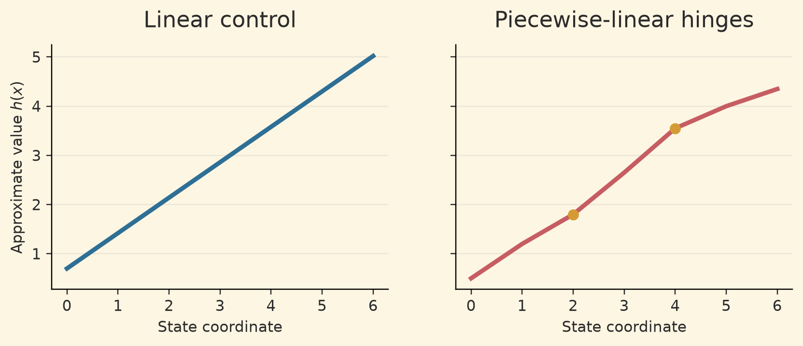
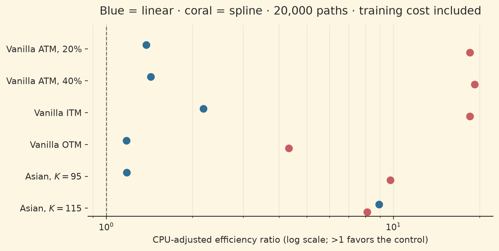

## Problem: pricing early-exercise options

::: {.columns}
::: {.column width="48%"}
**European**

Exercise only at maturity $T$. Under risk-neutral Black--Scholes dynamics,

$$
V_0^{E}=e^{-rT}\mathbb E^{\mathbb Q}[g_T(X_T)].
$$

A vanilla European payoff has a closed-form Black--Scholes price.
:::

::: {.column width="48%"}
**American / Bermudan**

American: exercise at any time up to $T$.

Bermudan: exercise only on a specified grid $t_0,\ldots,t_m$.

$$
V_0=\sup_{\tau\in\mathcal T}
\mathbb E^{\mathbb Q}[e^{-r\tau}g_\tau].
$$

The exercise time $\tau$ is a stopping time, not a fixed maturity.
:::
:::

**Challenge:** Black--Scholes dynamics still apply, but a single discounted terminal payoff no longer captures the early-exercise premium. We must solve an optimal stopping problem.

## Paper contribution: conventional regression methods

At eligible dates $t_k=k\Delta$, let $X_k$ be the Markov state and $g_k(X_k)$ the exercise payoff. For a vanilla put, $X_k=S_k$ and $g_k=(K-S_k)^+$.

**Bellman / Snell recursion**

$$
V_m=g_m,\qquad
C_k(x)=e^{-r\Delta}\mathbb E^{\mathbb Q}
[V_{k+1}(X_{k+1})\mid X_k=x],
$$

$$
V_k(x)=\max\{g_k(x),C_k(x)\}.
$$

- Exercise if $g_k(X_k)\ge C_k(X_k)$; otherwise continue.
- Longstaff--Schwartz (LSM): regress discounted realized future exercise cashflows on today's state.
- Tsitsiklis--Van Roy (TVR): approximate the Bellman value/continuation recursion by projecting one-step fitted value targets onto basis functions.

*Both use regression to approximate conditional expectations; this study uses LSM to learn the stopping rule.*

Sources: [Longstaff & Schwartz (2001)](https://doi.org/10.1093/rfs/14.1.113); [Tsitsiklis & Van Roy (2001)](https://doi.org/10.1109/72.935083).

## Paper contribution: how LSM learns a stopping rule

Simulate training paths and work backward from $k=m-1$ to $1$. Write $R_{k+1}^{(i)}$ for the realized future policy cashflow valued at $t_{k+1}$, starting with $R_m=g_m$.

**1. Fit continuation using least squares** (in-the-money paths)

$$
\widehat\beta_k=\arg\min_\beta
\sum_{i:g_k(X_k^{(i)})>0}
\left(e^{-r\Delta}R_{k+1}^{(i)}
-\beta^\top\phi(X_k^{(i)})\right)^2.
$$

For a vanilla put, use $x=S_k/K$, $\phi(x)=(1,x,x^2)^\top$ and $\widehat C_k(x)=\widehat\beta_k^\top\phi(x)$.

**2. Update the cashflow:** $R_k=g_k$ if in the money and $g_k\ge\widehat C_k$; otherwise $R_k=e^{-r\Delta}R_{k+1}$.

**3. Freeze $\pi$:** on independent pricing paths, stop at its first exercise date $\tau^\pi$ (or maturity).

The plain estimator is $\widehat L_0^\pi=N^{-1}\sum_i Y_i$, where $Y_i=e^{-r\tau_i^\pi}g_{\tau_i^\pi}$. It targets the feasible policy value, but its payoffs remain noisy.

## Paper contribution: Ehrlichman & Henderson (2007)

**Adaptive Control Variates for Pricing Multi-Dimensional American Options**

Given a feasible stopping policy $\pi$, define its value when starting at $t_k$:

$$
L_k^\pi(X_k)=\mathbb E^{\mathbb Q}\!
\left[e^{-r(\tau_k^\pi-t_k)}
g_{\tau_k^\pi}\mid X_k\right].
$$

- Fit $h_k(X_k)\approx L_k^\pi(X_k)$ using flexible, adaptive linear regression splines.
- Construct a zero-mean martingale from the one-step innovations of the fitted value functions.
- Subtract the martingale at exercise to reduce the variance of the lower-bound estimator; the paper also uses the martingale to obtain a dual upper bound.

**Two distinct regressions:** LSM fits continuation for exercise decisions (regression now); EH fits policy values at their own dates, then takes conditional expectations (regression later).

*Source: [Ehrlichman & Henderson (2007), §§2–4](https://doi.org/10.21314/jcf.2007.167). Our study isolates the lower-bound variance reduction.*

## EH's core theorem: a perfect control variate

For fixed policy $\pi$ and fitted functions $h_j$, set $D_j=e^{-rt_j}$ and define the martingale

$$
M_k^h=\sum_{j=1}^{k}D_j
\left(h_j(X_j)-\mathbb E[h_j(X_j)\mid\mathcal F_{j-1}]\right),
\qquad M_0^h=0.
$$

Each increment has conditional mean zero. Optional sampling at the bounded exercise time gives $\mathbb E[M_{\tau^\pi}^h]=0$ (subscript denotes evaluation at that exercise date). Conditional on frozen independent training,

$$
\widehat L_{0,\mathrm{CV}}^\pi=
\frac{1}{N}\sum_{i=1}^{N}
\left(Y_i-M_{\tau_i^\pi}^{h,(i)}\right).
$$

**Proposition 2.1.** If $h_j=L_j^\pi$, then before exercise $D_j\mathbb E[L_j^\pi\mid\mathcal F_{j-1}]=D_{j-1}L_{j-1}^\pi$. The stopped sum telescopes:

$$
M_{\tau^\pi}^{L}=Y-L_0^\pi
\quad\Longrightarrow\quad
Y-M_{\tau^\pi}^{L}=L_0^\pi
\quad\text{path by path}.
$$

The exact value function gives **zero variance**, but is unknown.

## Practical approximation I: fit the policy value

On separate training paths, form realized labels $R_k^\pi$: use $g_k$ if the frozen policy exercises at $k$, else $e^{-r\Delta}R_{k+1}^\pi$. Thus $\mathbb E[R_k^\pi\mid X_k]=L_k^\pi(X_k)$.

For normalized state $x=X_k/K$, fit $h_k(x)$ to these labels by least squares at each nonterminal date.

::: {.columns}
::: {.column width="55%"}
**Linear (additive)**

$$
h_k^{\rm lin}(x)=a_k+b_k^\top x.
$$

**Piecewise-linear spline (additive)**

$$
\begin{aligned}
h_k^{\rm spl}(x)=a_k+\sum_{d,\ell}
\big[&b^+_{k,d,\ell}(x_d-c_{k,d,\ell})_+\\
+&b^-_{k,d,\ell}(c_{k,d,\ell}-x_d)_+\big].
\end{aligned}
$$
:::

::: {.column width="43%"}
{width=100%}

*Hinges allow slopes to change at knots.*
:::
:::

Knots: training-state quartiles (25%, 50%, 75%); exact payoff at maturity. This restricted spline is not the full adaptive MARS of EH.

## Practical approximation II: compute the martingale

For a single spot coordinate under GBM, write $S'=S_{k+1}$, $s=S_k$, and $F=s e^{(r-q)\Delta}$.

**Linear:** $\mathbb E[S'/K\mid S_k=s]=F/K$, so

$$
\Delta M_{k+1}^{\rm lin}
=D_{k+1}\frac{b_{k+1}}{K}(S'-F)
$$

at nonterminal dates. The intercept cancels exactly.

**Spline:** a hinge at normalized knot $c$ is $(S'/K-c)_+=(S'-H)_+/K$, where $H=Kc$. For $H>0$,

$$
\begin{aligned}
\mathbb E[(S'-H)_+\mid s]&=F\Phi(d_1)-H\Phi(d_2),\\
d_1&=\frac{\log(s/H)+(r-q+\sigma^2/2)\Delta}
{\sigma\sqrt{\Delta}},\qquad d_2=d_1-\sigma\sqrt{\Delta}.
\end{aligned}
$$

Apply the analogous put-hinge formula for $(H-S')_+$ and subtract each expected basis value from its realized value. See Backup C for both signs and Asian hinges.

**Benefit:** exact one-step expectations, no nested simulation; the correction remains mean zero even when the fitted value is imperfect.

## Why a better approximation can reduce variance

Let $C=M_{\tau^\pi}^h$ be the stopped control. Our coefficient is fixed at one, so for independent pricing paths,

$$
\operatorname{Var}(\widehat L_{0,\mathrm{CV}}^\pi)
=\frac{\operatorname{Var}(Y)+\operatorname{Var}(C)
-2\operatorname{Cov}(Y,C)}{N}.
$$

Variance falls relative to plain LSMC iff $2\operatorname{Cov}(Y,C)>\operatorname{Var}(C)$.

**Link to approximation error:** let $\varepsilon_j=h_j(X_j)-L_j^\pi(X_j)$. By linearity of the martingale construction and EH's perfect-control identity,

$$
Y-M_{\tau^\pi}^h=L_0^\pi-M_{\tau^\pi}^{\varepsilon}.
$$

Orthogonality of stopped martingale increments then gives

$$
\operatorname{Var}(Y-M_{\tau^\pi}^h)
=\sum_{j=1}^m D_j^2\,
\mathbb E\!\left[\mathbf 1_{\{\tau^\pi\ge t_j\}}
\operatorname{Var}(\varepsilon_j\mid\mathcal F_{j-1})\right]
\le \sum_{j=1}^m D_j^2\mathbb E[\varepsilon_j^2].
$$

A spline can track nonlinear policy values better than a global line, reducing innovation error and potentially increasing VRF. **Improvement is not guaranteed.** All moments are conditional on the frozen training fits.

## What we actually implemented

**Independent streams:** 20k paths fit the LSM policy → freeze $\pi$ → 20k separate paths fit $h_j$ to $L_j^\pi$ → exact conditional expectations → paired evaluation paths.

::: {.columns}
::: {.column width="48%"}
**This study**

- Plain LSMC vs. linear $h_j$ vs. restricted additive hinge spline.
- Same frozen policy and paired pricing paths.
- Estimates target $L_0^\pi$; no policy change.
:::

::: {.column width="48%"}
**Not claimed**

- Full adaptive MARS / LDA-MARS.
- CV-enhanced policy improvement.
- Martingale-dual upper bound.
:::
:::

## Experimental design and checks

| Contract | Scenarios | Exercise dates |
|:--|:--|--:|
| Vanilla put, $K=40,\ T=1,\ r=6\%$ | ATM $\sigma=20\%,40\%$; ITM $S_0=36$; OTM $S_0=44$ | 12 monthly |
| Arithmetic Asian put, $S_0=100,\ T=0.5,\ \sigma=30\%$ | $K=95,115$ | 6 monthly |

**Training:** 20k policy-fit; 20k value-fit; 5k validation. **Pricing:** $N=5$k and 20k; 30 paired replications per size.

**Saved checks:** 26 tests passed; all 57 core numerical checks passed. Maximum stopped-martingale $|\text{mean}|/\text{SE}=2.865$.

## Main result: variance reduction

{width=84%}

At 20k paths, spline median VRF is **38.6–152.4×** for vanilla and **75.3–94.4×** for Asian. It exceeds linear in all six; VRF is a variance ratio, not a standard-error ratio.

## Variance is not price accuracy

{width=72%}

For $S_0=K=40,\ \sigma=20\%$, the spline interval is narrow but below CRR: **less sampling variance does not remove fixed-policy bias or make this an optimal-price CI.**

## Asian: a path-dependent demonstration

$$
A_k=\frac{S_1+\cdots+S_k}{k},\qquad \text{state }(S_k,A_k).
$$

The time-zero spot $S_0$ is excluded; exercise starts at month 1.

| Strike | Spline estimate of fixed-policy value | Median VRF |
|--:|--:|--:|
| $K=95$ | 2.739672 | 94.36× |
| $K=115$ | 15.896035 | 75.27× |

No exact Asian Bermudan price or upper bound was computed. EH §5.1 is related, but uses a log-geometric-average transformation—not this arithmetic-average setup.

## Cost and training-fit robustness

{width=75%}

Spline efficiency is **18.48×** for vanilla ATM 20% and **9.77×** for Asian K=95. Five-fit median VRFs stayed **37.7–171.0×**; timings are hardware-specific, and single-fit intervals omit training-fit uncertainty.

## Takeaways, limits, and questions

1. EH-inspired stopped-martingale controls are practical when the needed conditional expectations are tractable.
2. The restricted spline reduced variance far more than a linear control in these six saved scenarios.
3. **Precision is not optimal-policy accuracy:** the estimator values the frozen LSM policy.

**Scope:** no full adaptive MARS, no dual upper bound, no basket experiment, and no exact Asian benchmark.

**References**

- Ehrlichman, S. M. & Henderson, S. (2007). “Adaptive control variates for pricing multi-dimensional American options.” *The Journal of Computational Finance*, 11(1), 65–91. [doi:10.21314/jcf.2007.167](https://doi.org/10.21314/jcf.2007.167)
- Longstaff, F. A. & Schwartz, E. S. (2001). “Valuing American options by simulation: A simple least-squares approach.” *Review of Financial Studies*, 14(1), 113–147. [doi:10.1093/rfs/14.1.113](https://doi.org/10.1093/rfs/14.1.113)

\appendix

## Backup A | Vanilla VRF sensitivities

{width=88%}

Panels compare the same paired design at 5,000 and 20,000 paths.

## Backup B | What the correction does (illustrative sample)

{width=100%}

This is a representative 512-path subset from replication 0 of the saved $N=5{,}000$ archive. Its plotted VRF is a subset statistic—not the full-run median. Main results use the full saved replications.

## Backup C | Tractable hinge expectations

For $S'$ one GBM step from $s$, let

$$
d_1=\frac{\log(s/H)+(r-q+\sigma^2/2)\Delta}{\sigma\sqrt\Delta},
\qquad d_2=d_1-\sigma\sqrt\Delta .
$$

$$
\begin{aligned}
\mathbb E[(S'-H)_+\mid s]
&=se^{(r-q)\Delta}\Phi(d_1)-H\Phi(d_2),\\
\mathbb E[(H-S')_+\mid s]
&=H\Phi(-d_2)-se^{(r-q)\Delta}\Phi(-d_1).
\end{aligned}
$$

Assume $H>0$, $\sigma>0$, and $\Delta>0$. For $H\le0$, the call expectation is the forward minus $H$ and the put expectation is zero; zero volatility or time uses the deterministic forward.

For the arithmetic average, a hinge at $c$ has shifted spot threshold $H=kcK-(k-1)A_{k-1}$; its conditional expectation is the corresponding spot-hinge expectation divided by $kK$. No nested Monte Carlo is needed.
