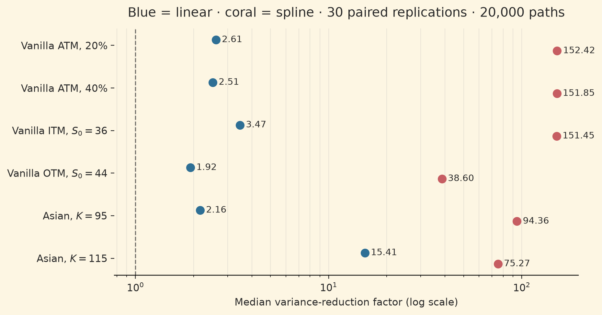
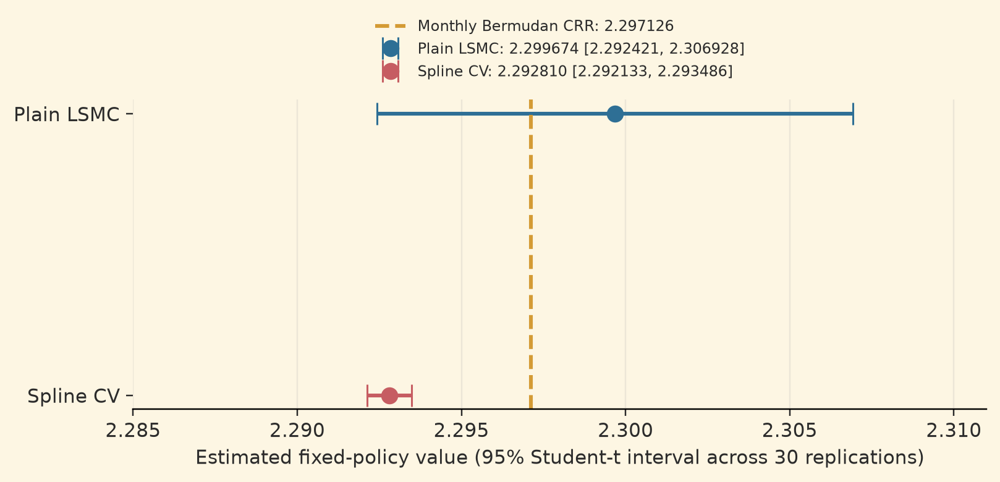
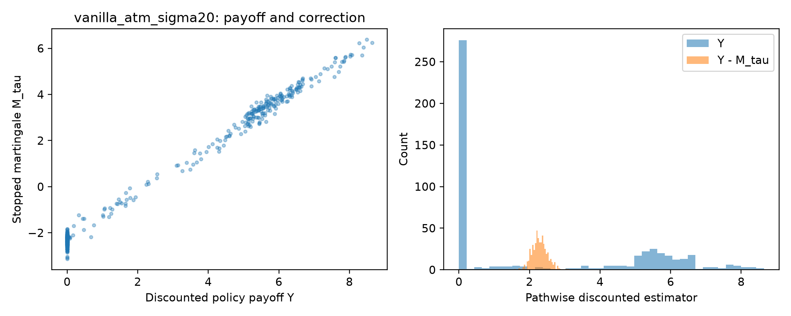

## Problem and paper contribution

::: {.columns}
::: {.column width="48%"}
**The problem**

- Monte Carlo can value a feasible exercise policy.
- Each path's discounted payoff is noisy.
- A good estimate needs fewer paths, not a different exercise decision.
:::

::: {.column width="48%"}
**Ehrlichman–Henderson's idea**

- Approximate the value of a fixed policy.
- Use its conditional expectations to build a stopped martingale.
- Subtract that zero-mean correction to reduce path variance.
:::
:::

**Question:** How much variance can simple, tractable approximations remove in our LSMC study?

## Minimal stopping / LSMC background

For a put, immediate exercise pays $(K-S_t)^+$. At each eligible date, LSMC compares this with a fitted continuation value and freezes the resulting exercise rule $\pi$.

**Monthly Bermudan dates:** $t_0=0 \longrightarrow t_1 \longrightarrow \cdots \longrightarrow t_{12}=T$

The out-of-sample stopping time $\tau^\pi$ is the **first** date that frozen rule exercises (or maturity).

*Background: [Longstaff & Schwartz (2001)](https://doi.org/10.1093/rfs/14.1.113).*

## EH's core theorem: a perfect control variate

For a fixed policy and state $X_j$, define

$$
M_k=\sum_{j=1}^{k}e^{-rt_j}
\left\{h_j(X_j)-\mathbb E[h_j(X_j)\mid\mathcal F_{j-1}]\right\},
$$

Conditionally on independent, frozen training, optional sampling gives $\mathbb E[M_{\tau^\pi}]=0$ for the bounded stopping time.

With $Y=e^{-r\tau^\pi}g_{\tau^\pi}(X_{\tau^\pi})$, estimate the same policy value by

$$
\widehat L_0^\pi=\frac{1}{N}\sum_{i=1}^{N}\left(Y_i-M_{\tau_i^\pi}^{(i)}\right).
$$

If $h_j=L_j^\pi$, then $Y-M_{\tau^\pi}=L_0^\pi$ **path by path**: zero variance. In practice, $h_j$ is approximate; variance reduction is not guaranteed.

*Source: [Ehrlichman & Henderson (2007), §2.2, Proposition 2.1](https://doi.org/10.21314/jcf.2007.167).*

## Practical approximation: linear versus spline

{width=72%}

$$
h_{\rm lin}(x)=a+bx
\qquad
h_{\rm spl}(x)=a+\sum_{d,\ell}
\left[b^+_{d\ell}(x_d-c_{d\ell})_+
+b^-_{d\ell}(c_{d\ell}-x_d)_+\right].
$$

Exact GBM hinge expectations avoid nested simulation. Our fixed-knot additive spline is **not** the paper's full adaptive MARS.

*Method inspiration: [Ehrlichman & Henderson (2007), §§3–3.1](https://doi.org/10.21314/jcf.2007.167).*

## What we actually implemented

**Independent streams:** 20k paths fit the LSM policy → freeze $\pi$ → 20k separate paths fit $h_j$ to $L_j^\pi$ → exact conditional expectations → paired evaluation paths.

::: {.columns}
::: {.column width="48%"}
**This study**

- Plain LSMC vs. linear $h_j$ vs. restricted additive hinge spline.
- Same frozen policy and paired pricing paths.
- Estimates target $L_0^\pi$; no policy change.
:::

::: {.column width="48%"}
**Not claimed**

- Full adaptive MARS / LDA-MARS.
- CV-enhanced policy improvement.
- Martingale-dual upper bound.
:::
:::

## Experimental design and checks

| Contract | Scenarios | Exercise dates |
|:--|:--|--:|
| Vanilla put, $K=40,\ T=1,\ r=6\%$ | ATM $\sigma=20\%,40\%$; ITM $S_0=36$; OTM $S_0=44$ | 12 monthly |
| Arithmetic Asian put, $S_0=100,\ T=0.5,\ \sigma=30\%$ | $K=95,115$ | 6 monthly |

**Training:** 20k policy-fit; 20k value-fit; 5k validation. **Pricing:** $N=5$k and 20k; 30 paired replications per size.

**Saved checks:** 26 tests passed; all 57 core numerical checks passed. Maximum stopped-martingale $|\text{mean}|/\text{SE}=2.865$.

## Main result: variance reduction

{width=84%}

At 20k paths, spline median VRF is **38.6–152.4×** for vanilla and **75.3–94.4×** for Asian. It exceeds linear in all six; VRF is a variance ratio, not a standard-error ratio.

## Variance is not price accuracy

{width=72%}

For $S_0=K=40,\ \sigma=20\%$, the spline interval is narrow but below CRR: **less sampling variance does not remove fixed-policy bias or make this an optimal-price CI.**

## Asian: a path-dependent demonstration

$$
A_k=\frac{S_1+\cdots+S_k}{k},\qquad \text{state }(S_k,A_k).
$$

The time-zero spot $S_0$ is excluded; exercise starts at month 1.

| Strike | Spline estimate of fixed-policy value | Median VRF |
|--:|--:|--:|
| $K=95$ | 2.739672 | 94.36× |
| $K=115$ | 15.896035 | 75.27× |

No exact Asian Bermudan price or upper bound was computed. EH §5.1 is related, but uses a log-geometric-average transformation—not this arithmetic-average setup.

## Cost and training-fit robustness

{width=75%}

Spline efficiency is **18.48×** for vanilla ATM 20% and **9.77×** for Asian K=95. Five-fit median VRFs stayed **37.7–171.0×**; timings are hardware-specific, and single-fit intervals omit training-fit uncertainty.

## Takeaways, limits, and questions

1. EH-inspired stopped-martingale controls are practical when the needed conditional expectations are tractable.
2. The restricted spline reduced variance far more than a linear control in these six saved scenarios.
3. **Precision is not optimal-policy accuracy:** the estimator values the frozen LSM policy.

**Scope:** no full adaptive MARS, no dual upper bound, no basket experiment, and no exact Asian benchmark.

**References**

- Ehrlichman, S. M. & Henderson, S. (2007). “Adaptive control variates for pricing multi-dimensional American options.” *The Journal of Computational Finance*, 11(1), 65–91. [doi:10.21314/jcf.2007.167](https://doi.org/10.21314/jcf.2007.167)
- Longstaff, F. A. & Schwartz, E. S. (2001). “Valuing American options by simulation: A simple least-squares approach.” *Review of Financial Studies*, 14(1), 113–147. [doi:10.1093/rfs/14.1.113](https://doi.org/10.1093/rfs/14.1.113)

\appendix

## Backup A | Vanilla VRF sensitivities

{width=88%}

Panels compare the same paired design at 5,000 and 20,000 paths.

## Backup B | What the correction does (illustrative sample)

{width=100%}

This is a representative 512-path subset from replication 0 of the saved $N=5{,}000$ archive. Its plotted VRF is a subset statistic—not the full-run median. Main results use the full saved replications.

## Backup C | Tractable hinge expectations

For $S'$ one GBM step from $s$, let

$$
d_1=\frac{\log(s/H)+(r-q+\sigma^2/2)\Delta}{\sigma\sqrt\Delta},
\qquad d_2=d_1-\sigma\sqrt\Delta .
$$

$$
\begin{aligned}
\mathbb E[(S'-H)_+\mid s]
&=se^{(r-q)\Delta}\Phi(d_1)-H\Phi(d_2),\\
\mathbb E[(H-S')_+\mid s]
&=H\Phi(-d_2)-se^{(r-q)\Delta}\Phi(-d_1).
\end{aligned}
$$

Assume $H>0$, $\sigma>0$, and $\Delta>0$. For $H\le0$, the call expectation is the forward minus $H$ and the put expectation is zero; zero volatility or time uses the deterministic forward.

For the arithmetic average, a hinge at $c$ has shifted spot threshold $H=kcK-(k-1)A_{k-1}$; its conditional expectation is the corresponding spot-hinge expectation divided by $kK$. No nested Monte Carlo is needed.
