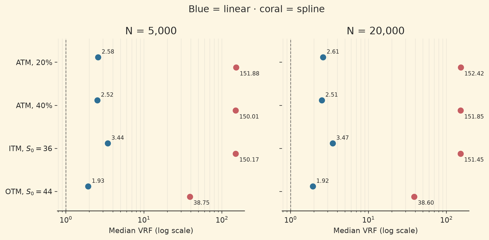

## European, American, and Bermudan

::: {.columns}
::: {.column width="55%"}
- **European:** exercise only at maturity.
- **American:** exercise any time over the contract life.
- **Bermudan:** exercise only on a discrete grid.
:::

::: {.column width="42%"}
**This project**

- Vanilla: 12 monthly dates, 13 grid points including $0$.
- Asian: 6 monthly dates, no exercise at time $0$.
:::
:::

The European Black--Scholes discounted terminal-payoff formula is analytic under its assumptions, but it **does not directly price an early-exercise put**. Free-boundary PDE methods and matched-grid trees can price American/Bermudan puts. This repository uses the monthly Bermudan approximation.

::: {.notes}
0:30 . Distinguish contracts; correct the "BSM is unusable" misconception.
:::

## Conventional stopping rules: LSM and TVR

$$
e^{-r\Delta}\,\mathbb E[C_{k+1}\mid S_k]
\quad\text{vs.}\quad
(K-S_k)^+
$$

- **LSM (Longstaff--Schwartz):** regress discounted realized future **exercise cashflows**, typically in-the-money, to approximate continuation and choose stopping.
- **TVR (Tsitsiklis--Van Roy):** approximate the value/backward Bellman recursion by regressing next-step fitted values.

This project implements LSMC as the conventional approach for benchmarking the fixed-policy martingale control variates.

An illustrative vanilla basis is $(1,x,x^2)$, $x=S/K$. The frozen rule $\pi$ is applied out of sample to obtain $\tau^\pi$.

::: {.notes}
0:40 . Separate the two regression targets.
:::

## Paper Contribution by Ehrlichman--Henderson (2007)

EH builds control variates around a **fixed exercise policy**:

- Approximate the policy value $L_k^\pi$.
- Center Markov state functions into martingale increments.
- Use Proposition 2.1 to prove exact zero variance when $h_k=L_k^\pi$.
- MARS/LDA-MARS fits, CV-aided stopping policy, and a martingale-dual upper bound extend the method.

**This study:** independent frozen LSM policy + fixed-knot additive hinges. It is a lower-bound policy estimator, not the full EH adaptive system.

::: {.notes}
0:35 . Show the paper overview and scope boundary.
:::

## Price a fixed LSM policy

Let $\tau^\pi$ be the first exercise selected by the frozen policy, or maturity.

$$
Y=e^{-r\tau^\pi}g_{\tau^\pi}(X_{\tau^\pi}),\qquad
\widehat L_0^\pi=\frac1N\sum_{i=1}^N Y_i
$$

Plain Monte Carlo estimates
$$
\operatorname{Var}\!\left(\widehat L_0^\pi\right)
=\frac{\operatorname{Var}(Y)}{N}.
$$

The exercise rule is fixed. LSMC's continuation regression produces $\pi$; every subsequent estimator uses the same $\pi$, with no policy re-optimization.

::: {.notes}
0:35 . Introduce Y, the stopping time, and plain Monte Carlo.
:::

## EH martingale correction

For approximate policy values $h_k(X_k)$,
$$
M_k=\sum_{j=1}^{k}e^{-rt_j}
\left[h_j(X_j)-\mathbb E[h_j(X_j)\mid\mathcal F_{j-1}\right].
$$

**Optional sampling:** each increment is conditionally mean zero, so $\mathbb E[M_{\tau^\pi}]=0$ for the bounded stopping time.

The stopped-CV estimator is
$$
\widehat L_{\rm CV}
=\frac1N\sum_i\left(Y_i-M_{\tau_i^\pi}^{(i)}\right).
$$

It has the same policy-value expectation as plain Monte Carlo; a coefficient-one correction changes sampling variance, not exercise decisions.

::: {.notes}
0:40 . Derive the centered increment and stopped estimator.
:::

## Perfect control, proof, and VRF

If $h_j=L_j^\pi$, then the process telescopes and
$$
Y-M_{\tau^\pi}=L_0^\pi
\quad\text{path by path}.
$$
Thus the exact fixed-policy value gives **zero variance**.

For an approximation $h$, covariance decomposition shows which correlation remains:
$$
\operatorname{Var}(Y-M_\tau)
=\operatorname{Var}(Y)+\operatorname{Var}(M_\tau)
-2\operatorname{Cov}(Y,M_\tau).
$$

$$
\mathrm{VRF}
=\frac{\operatorname{Var}(Y)}{\operatorname{Var}(Y-M_\tau)}.
$$
A VRF of $152.42\times$ means variance $152.42\times$ smaller, while standard-error reduction is $\sqrt{152.42}=12.35\times$.

::: {.notes}
0:50 . Explain Proposition 2.1, telescoping, and covariance/VRF.
:::

## Linear control: state and exact GBM term

$$
h_k^{lin}(x)=a_k+b_kx,\qquad
h_k^{lin}(x,u)=a_k+b_kx+c_ku
$$

for vanilla and Asian states, respectively. Put-like fitted value functions decrease as spot or average rises.

Under GBM,
$$
F_{k|k-1}=\mathbb E[S_k\mid\mathcal F_{k-1}]
=S_{k-1}e^{(r-q)\Delta}.
$$

Vanilla, nonterminal:
$$
\Delta M_k^{lin}
=e^{-rt_k}\frac{b_k}{K}(S_k-F_{k|k-1}).
$$

No nested Monte Carlo: the stock innovation conditional expectation is analytic.

::: {.notes}
0:35 . Explain stock innovation and linear fitted slope.
:::

## Spline control: fixed-knot additive hinges

$$
h_k^{spl}(x)
=a_{k,0}
+\sum_{d,\ell}\left[
b^+_{k,d,\ell}(x_d-c_{k,d,\ell})^+
+b^-_{k,d,\ell}(c_{k,d,\ell}-x_d)^+
\right].
$$

- State coordinates: $S/K$; Asian also $A/K$.
- Knots: 25%, 50%, 75% training quantiles, per date and coordinate.
- Duplicate knots removed; additive, no cross interaction.
- Rank-aware ridge fallback; maturity remains exact payoff.

A spline changes slope in different spot/average regions, whereas linear $h$ has one global slope. These are fixed restricted knots, not EH's adaptive MARS.

::: {.notes}
0:45 . Define the implemented fixed-knot spline and restriction.
:::

## Exact hinge expectations

Each forward/reverse spot hinge has a lognormal Black--Scholes formula:
$$
\mathbb E[(S'-H)^+\mid S=s]
=se^{(r-q)\Delta}\Phi(d_1)-H\Phi(d_2),
$$
$$
\mathbb E[(H-S')^+\mid S=s]
=H\Phi(-d_2)-se^{(r-q)\Delta}\Phi(-d_1).
$$

For a normalized Asian average hinge,
$$
\mathbb E[(A_k-cK)^+\mid\mathcal F_{k-1}]
=\frac1k\,\mathbb E[(S_k-H)^+\mid\mathcal F_{k-1}],
$$
$$
H=kcK-(k-1)A_{k-1}.
$$

The conditional expectation is analytic; no nested Monte Carlo is used.

::: {.notes}
0:35 . Move the exact expectations off the implementation slides and into one proof slide.
:::

## Experimental scenarios and protocol

::: {.columns}
::: {.column width="67%"}
| Contract / scenario | $S_0$ | $K$ | $\sigma$ | $T$ | Dates |
|:--|--:|--:|--:|--:|:--|
| Vanilla ATM low vol | 40 | 40 | .20 | 1 | 0-12 |
| Vanilla ATM high vol | 40 | 40 | .40 | 1 | 0-12 |
| Vanilla ITM | 36 | 40 | .20 | 1 | 0-12 |
| Vanilla OTM | 44 | 40 | .20 | 1 | 0-12 |
| Asian K95 | 100 | 95 | .30 | .5 | 1-6 |
| Asian K115 | 100 | 115 | .30 | .5 | 1-6 |
:::
::: {.column width="29%"}
**Common inputs**

- $r=.06,\ q=0$
- 12 monthly / 6 monthly
- $A_k=\sum_{j=1}^{k}S_j/k$
- GBM risk-neutral paths

**Benchmarks**

- CRR 1200 / 2400 steps aligned to 13 vanilla dates
- No exact Asian CRR
:::
:::

$$
\text{20k policy} \rightarrow \pi
\rightarrow \text{20k value fit}
\rightarrow \text{5k validation}
\rightarrow \text{30x5k/20k paired runs}
$$

All VRFs at N=20k are medians over 30 paired pricing replications.

::: {.notes}
0:50 . Read scenario parameters and independent experiment flow.
:::

## 12 | Linear control: concrete implementation

**Policy fit first**

1. Fit LSM continuation on 20k paths; freeze $\pi$.
2. Independently generate 20k value-training paths.
3. Form realized future frozen-policy cashflow labels $L_k^\pi$.
4. Fit linear $h_k$; keep terminal $h_T=g_T$ exact.

**Asian increment**
$$
\mathbb E[A_k\mid\mathcal F_{k-1}]
=\frac{(k-1)A_{k-1}+F_{k|k-1}}{k},
$$
$$
\Delta M_k^{lin}
=e^{-rt_k}\frac{b_k+c_k/k}{K}
(S_k-F_{k|k-1}).
$$

The per-path estimator is $Y_i-\sum_{k\le\tau_i^\pi}\Delta M_{i,k}^{lin}$. Plain LSMC is the same frozen policy with no correction.

::: {.notes}
0:40 . Separate policy regression from independently fitted policy-value approximation.
:::

## 13 | Linear CV vs plain LSMC

Moderate gains: 1.92-3.47x vanilla; 2.16-15.41x Asian.

**Vanilla puts**

| Scenario | Plain | Linear | Median VRF |
|:--|--:|--:|--:|
| ATM $\sigma20$ | 2.29967 | 2.29292 | 2.61x |
| ATM $\sigma40$ | 5.29589 | 5.28967 | 2.51x |
| ITM $S_0=36$ | 4.44051 | 4.43799 | 3.47x |
| OTM $S_0=44$ | 1.09464 | 1.09538 | 1.92x |
**Arithmetic Asian puts**

| Strike | Plain | Linear | Median VRF |
|--:|--:|--:|--:|
| K95 | 2.74156 | 2.74450 | 2.16x |
| K115 | 15.89030 | 15.89467 | 15.41x |

::: {.notes}
0:55 . Present staged linear evidence, define VRF once more.
:::

## 14 | Spline control: concrete implementation

Use 25/50/75% training quantiles as fixed knots:
$$
h_k^{spl}(x)
=a+\sum_{d,\ell}\left[
b^+(x_d-c)^+ + b^-(c-x_d)^+
\right].
$$

- Fit one separate spline to backward realized-policy labels on 20k value-training paths.
- Vanilla: $x=S/K$; Asian: $x=(S/K,A/K)$.
- Frozen knots/coefs; no fit on pricing paths.
- Additive only; ridge fallback for rank/ill-conditioning.
- Terminal $h_T=g_T$ exact.

Conditional expectation is the sum of analytic spot/shifted-average hinge expectations. $\widehat L_{spl}$ = mean $Y-M_\tau^{spl}$.

**EH full MARS is more adaptive.**

::: {.notes}
0:45 . Describe the exact restricted spline implementation.
:::

## 15 | Spline CV vs plain LSMC

Substantial gains: 38.60-152.42x vanilla; 75.27-94.36x Asian. VRF is variance ratio.

**Vanilla puts**

| Scenario | Plain | Spline | Median VRF |
|:--|--:|--:|--:|
| ATM $\sigma20$ | 2.29967 | 2.29281 | 152.42x |
| ATM $\sigma40$ | 5.29589 | 5.28706 | 151.85x |
| ITM $S_0=36$ | 4.44051 | 4.43915 | 151.45x |
| OTM $S_0=44$ | 1.09464 | 1.09616 | 38.60x |
**Arithmetic Asian puts**

| Strike | Plain | Spline | Median VRF |
|--:|--:|--:|--:|
| K95 | 2.74156 | 2.73967 | 94.36x |
| K115 | 15.89030 | 15.89604 | 75.27x |

::: {.notes}
0:1:05 . Central empirical slide: spline vs plain, with correct VRF interpretation.
:::

## 16 | Overall evaluation

::: {.columns}
::: {.column width="44%"}
**Plain -> linear -> spline**

- Vanilla ATM20: 1x -> 2.61x -> 152.42x
- Asian K95: 1x -> 2.16x -> 94.36x

**Matched ATM20 reference**

- Monthly Bermudan CRR: 2.297126
- Plain: 2.299674
- Linear: 2.292915
- Spline: 2.292810
:::
::: {.column width="54%"}
{width=100%}
:::
:::

Spline 95% conditional replication interval $[2.292133,2.293486]$ excludes CRR. That is consistent with fixed-policy approximation bias; CV variance reduction does not remove it.

::: {.notes}
0:55 . Direct head-to-head then a policy-bias caveat.
:::

## 17 | Conclusions

1. **Exact policy value functions** would yield perfect stopped-martingale controls; tractable conditional expectations make practical approximations possible.
2. **Linear controls help**, but the restricted spline gives much larger VRFs across tested vanilla and Asian cases.
3. Both CVs estimate the **same frozen-policy value**. Greater precision is not better optimal stopping.

**Limits:** no full adaptive MARS, no policy re-optimization, no martingale-dual upper bound, no exact Asian optimal-value benchmark.

*Ehrlichman & Henderson (2007), The Journal of Computational Finance 11(1), 65-91.*

::: {.notes}
0:30 . Close with three takeaways and limits.
:::

## Backup A | CPU efficiency and fit robustness

{width=78%}

- Spline CPU efficiency: vanilla ATM20 18.48x; Asian K95 9.77x.
- Five independent spline training fits showed VRFs 37.7-171.0x; variability beyond frozen-fit CIs.
- Timings are hardware-specific.

## Backup B | Vanilla VRF sensitivity

{width=88%}

## Backup C | 512-path correction illustration

{width=88%}

Illustrative subset from replication 0 of the N=5,000 archive; not a full-run median.

## Backup D | Detailed GBM hinge formulas

For $S'$ one GBM step from $s$, let
$$
d_1=\frac{\log(s/H)+(r-q+\sigma^2/2)\Delta}{\sigma\sqrt\Delta},
\quad d_2=d_1-\sigma\sqrt\Delta.
$$
$$
\mathbb E[(S'-H)^+\mid s]=se^{(r-q)\Delta}\Phi(d_1)-H\Phi(d_2),
$$
$$
\mathbb E[(H-S')^+\mid s]=H\Phi(-d_2)-se^{(r-q)\Delta}\Phi(-d_1).
$$

$H>0$, $\sigma>0$, $\Delta>0$. For $H\le0$, call $=se^{(r-q)\Delta}-H$ and put $=0$. Zero $\sigma$ or $\Delta$ uses the deterministic forward.

## Backup E | Method differences and complete scope

- EH full method: adaptive MARS/LDA-MARS; CV-aided stopping; martingale-dual upper bound.
- This study: fixed 25/50/75% knots, additive hinges, independently fitted frozen LSM policy, lower-bound policy estimate.
- Policy fit: 20k paths; value fit: 20k; validation: 5k; pricing: 30x5k/20k paired replications.
- 26/26 smoke tests; 57/57 core checks; max stopped-martingale $|z|\approx2.865$.
